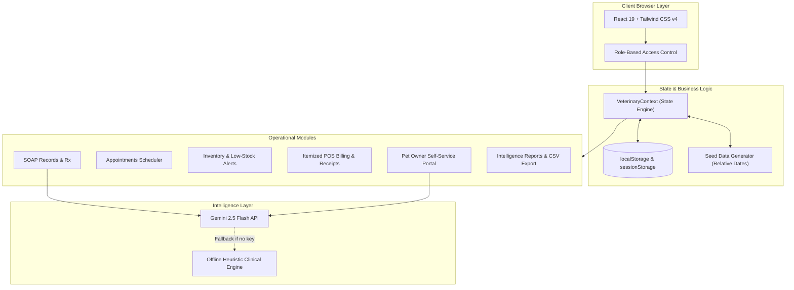

# 🐾 WellPet VetCore Pro
### Enterprise Veterinary Practice Management System (VMS) & Pet Owner Client Health Portal

[](https://react.dev/)
[](https://www.typescriptlang.org/)
[](https://vitejs.dev/)
[](https://tailwindcss.com/)
[](https://ai.google.dev/)
[](https://github.com/rgdlcatacutan02-beep/veterinary-clinic-management-system/actions/workflows/ci.yml)
[](LICENSE)

---

## 🌟 Overview

**WellPet VetCore Pro** is a modern, full-stack responsive web application engineered for veterinary clinics, animal hospitals, and pet health practices. It delivers a unified, role-governed clinical operations platform coupled with an intuitive self-service portal for pet owners.

The platform streamlines clinical workflows, SOAP medical charting, diagnostic lab orders, surgical tracking, appointment scheduling, itemized billing, multi-supplier inventory control, and compliance audit logging — enhanced by **Google Gemini AI** for clinical consultation drafting and pet wellness triage.

---

## 🚀 Quick Demo Logins

The application comes pre-loaded with comprehensive clinical data. Use the **1-Click Login Cards** on the login screen or sign in manually using any of the credentials below:

| Role | Name | Username / Email | Password | Primary Capabilities |
| :--- | :--- | :--- | :--- | :--- |
| **Admin** | Dr. Sarah Jenkins | `Admin` | `admin1234` | Full clinical access, staff roster, financial reports, audit logs |
| **Veterinarian** | Dr. Robert Taylor | `dr.taylor` | `staff1234` | Patient charting, AI SOAP consults, surgeries, prescriptions, labs |
| **Receptionist** | Emily Clark | `emily.clark` | `staff1234` | Front desk scheduler, patient check-in/out, invoices & payments |
| **Pet Owner** | John Doe | `john.doe` | `client1234` | Pet wellness timeline, vaccine certs, visit booking, billing |

> 💡 **Tip**: Click **"Reset Demo"** in the header or login screen anytime to restore the complete sample database.

---

## ✨ Key Features

### 🩺 Clinical Hub
- **SOAP Medical Consultations**: Standardized Subjective, Objective, Assessment, and Plan documentation with owner visibility toggles.
- **AI Clinical Assistant (Powered by Gemini)**: Automatically analyzes species, breed, and chief complaints to generate structured diagnostic assessments and treatment plans (with offline clinical fallback).
- **Vaccination Booster Ledger**: Tracks rabies, core combos, and kennel cough with automated overdue warning badges.
- **Digital Rx Prescription Tracker**: Tracks medications, dosages, administration frequencies, refill durations, and printable Rx slips.
- **Pathology & Lab Orders**: Clinical CBC chemistry panels, skin cytologies, urinalysis, and attachment management.
- **Surgical Database**: Pre-op planning, surgeon attribution, surgical outcome summaries, and post-op discharge instructions.

### 🏢 Clinic Operations & Administration
- **Interactive Scheduler**: Multi-status appointment calendar (Scheduled, Checked In, Completed, Cancelled) filtered by date and visit type.
- **Itemized Billing & POS**: Dynamic line-item billing, automatic tax calculations, partial payments tracking, and printable receipts.
- **Inventory & Pharmacy Control**: Multi-supplier stock management, real-time threshold warnings (`Low Stock`), and expiration date alerts.
- **Staff Roster Management**: Add, deactivate, and assign role-based permissions across clinic personnel.
- **Intelligence Reports & Analytics**: Operational revenue metrics, collection rates, appointment throughput, and **real CSV export**.
- **Immutable Security Audit Log**: Regulatory logging of all user authentications, medical edits, and drug dispensing with CSV export.

### 🐾 Self-Service Pet Owner Portal
- **Family Pets Registry**: Detailed animal profiles, breed details, allergy notices, and biometric weight progression graphs.
- **Medical History & Vaccine Certificates**: Owners can view released clinical summaries and print vaccination certificates.
- **Prescriptions & Medications**: Dedicated tracker for active/completed medications with dosage instructions and printable Rx slips.
- **Online Visit Booking**: Pet owners can request consultation, booster, or grooming appointments directly.
- **Digital Invoicing & Payments**: Transparent invoice inspection with instant online card settlement simulation.

---

## 🏗️ System Architecture



---

## 🛠️ Technology Stack

- **Frontend Core**: [React 19](https://react.dev/) & [TypeScript 5.8](https://www.typescriptlang.org/)
- **Bundler & Build**: [Vite 6](https://vitejs.dev/)
- **Styling**: [Tailwind CSS v4](https://tailwindcss.com/) with modern `@theme` variables & `@tailwindcss/vite`
- **Icons**: [Lucide React](https://lucide.dev/)
- **AI Integration**: [@google/genai SDK](https://www.npmjs.com/package/@google/genai)
- **State Persistence**: Browser `localStorage` with reactive state synchronization and zero-dependency offline resilience

---

## 💻 Getting Started Locally

### Prerequisites
- **Node.js**: Version 18.0 or higher
- **npm**: Version 9.0 or higher

### Installation

1. **Clone the repository**:
   ```bash
   git clone https://github.com/rgdlcatacutan02-beep/veterinary-clinic-management-system.git
   cd veterinary-clinic-management-system
   ```

2. **Install dependencies**:
   ```bash
   npm install
   ```

3. **(Optional) Configure Gemini AI API Key**:
   Create a `.env.local` file based on `.env.example`:
   ```bash
   cp .env.example .env.local
   ```
   Add your Gemini API key:
   ```env
   VITE_GEMINI_API_KEY=your_gemini_api_key_here
   ```
   > *Note: If no API key is provided, the application automatically uses the built-in offline clinical engine. Every feature remains fully functional!*

4. **Launch the development server**:
   ```bash
   npm run dev
   ```
   Open your browser at `http://localhost:3000`.

5. **Type Checking & Linting**:
   ```bash
   npm run lint
   ```

6. **Production Build**:
   ```bash
   npm run build
   ```

---

## 📁 Project Structure

```
veterinary-clinic-management-system/
├── src/
│   ├── components/
│   │   ├── Header.tsx             # Global navigation bar & session status
│   │   ├── Sidebar.tsx            # Role-aware responsive navigation drawer
│   │   └── LoginView.tsx          # Authentication screen with 1-click quick logins
│   ├── context/
│   │   └── VeterinaryContext.tsx  # Central state engine & persistence
│   ├── data/
│   │   └── seedData.ts            # Realistic clinical demo datasets & reset utility
│   ├── services/
│   │   └── geminiService.ts       # Gemini 2.5 Flash clinical AI & offline fallback
│   ├── views/
│   │   ├── clinic/
│   │   │   ├── ClinicDashboard.tsx    # Executive clinical KPI dashboard
│   │   │   ├── ClientsPetsView.tsx    # Patient registry & weight chart tracker
│   │   │   ├── SchedulerView.tsx      # Multi-view appointment scheduler
│   │   │   ├── MedicalRecordsView.tsx # SOAP consults with Gemini AI assistant
│   │   │   ├── VaccinationsView.tsx   # Vaccine booster tracker & cert printer
│   │   │   ├── PrescriptionsView.tsx  # Drug dispatch ledger & Rx slips
│   │   │   ├── LabsView.tsx           # Diagnostic lab orders & pathology
│   │   │   ├── SurgeriesView.tsx      # Surgical scheduler & discharge summaries
│   │   │   ├── BillingView.tsx        # Invoicing, POS settlements & receipt print
│   │   │   ├── InventoryView.tsx      # Stock alerts, expiry monitor & suppliers
│   │   │   ├── StaffView.tsx          # Staff permissions & account management
│   │   │   ├── ReportsView.tsx        # Financial analytics & real CSV export
│   │   │   └── AuditLogsView.tsx      # Immutable security ledger & CSV export
│   │   └── portal/
│   │       └── PetOwnerPortal.tsx     # Client portal with pets, appointments, Rx & billing
│   ├── types.ts                   # Domain entity TypeScript declarations
│   ├── App.tsx                    # Root routing & layout orchestrator
│   ├── index.css                  # Tailwind CSS v4 design tokens & fonts
│   └── main.tsx                   # React entrypoint
├── index.html                     # HTML5 shell with responsive metadata & favicon
├── vite.config.ts                 # Vite bundler configuration
├── package.json                   # Project manifest & dependencies
└── README.md                      # Documentation
```

---

## 📄 License

Distributed under the **MIT License**. See [`LICENSE`](LICENSE) for details.
